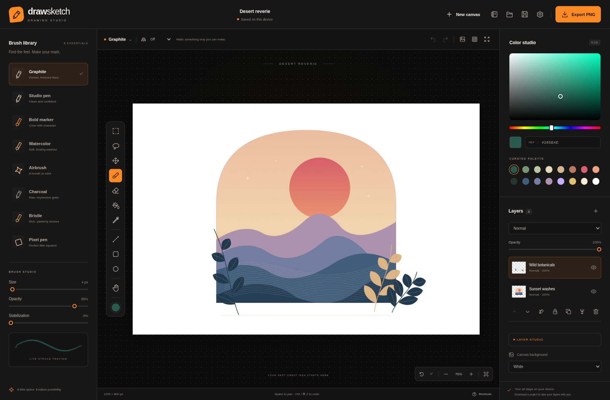
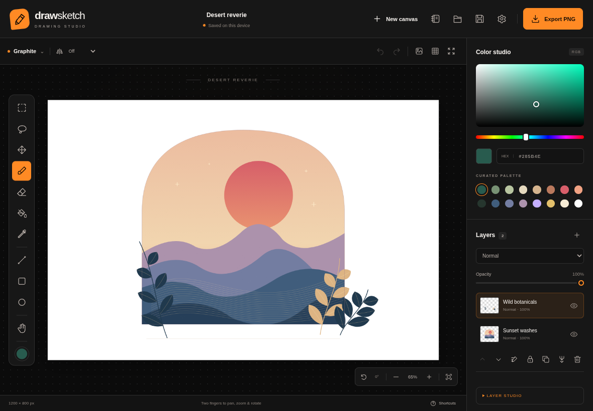
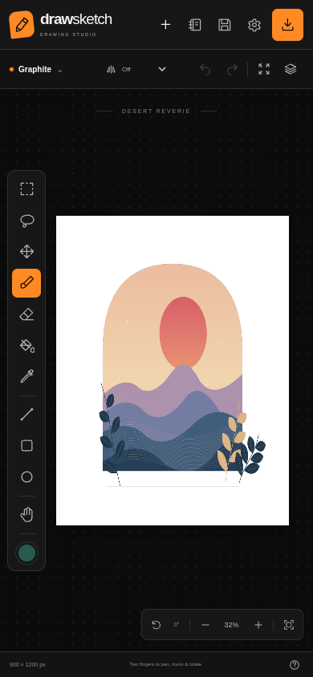
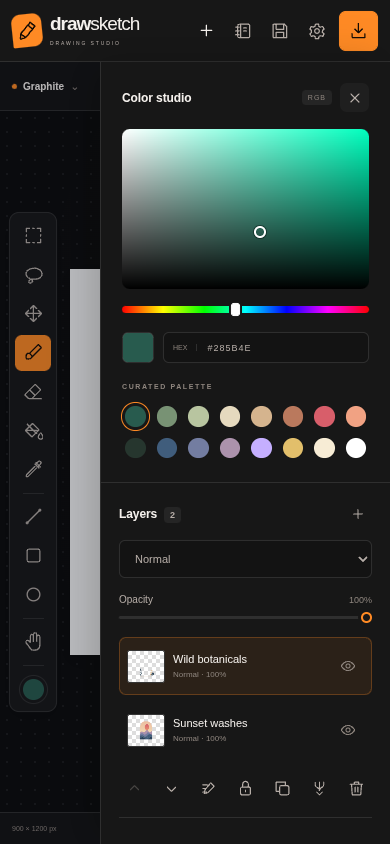

# DrawSketch

**Your studio. Everywhere.**

A personal drawing studio for desktop, tablet, and phone, with an orange and black workspace. Pick up a pen, make a little mess, and find your flow. DrawSketch combines a focused canvas with expressive brushes, non-destructive masks, selections, brush presets, touch gestures, and a sketchbook that stays on your device.

Built with JavaScript, Canvas 2D, and Vite. No account, API key, backend, or uploaded artwork required.

## A studio for every screen

These are actual screenshots of the running production app, captured with Chromium. The artwork is an original, editable Canvas demonstration included with the app.

### Desktop

Your brush library, canvas, colors, and layers in one workspace.



### Tablet

A larger canvas, stylus support, and two-finger navigation. Tap the active brush name to open the full brush studio.



### Phone

A dedicated compact layout with colors and layers available in a drawer.

<p>
  
  
</p>

## Made for the way you draw

| Area             | What you can do                                                                                                                                                                |
| ---------------- | ------------------------------------------------------------------------------------------------------------------------------------------------------------------------------ |
| Brushes          | Graphite, studio pen, marker, watercolor, airbrush, charcoal, bristle, and pixel pen, each with a different stroke engine                                                      |
| Stroke control   | Adjust size, opacity, stabilization, pen pressure and tilt; paper grain, canvas weave, color pickup, and saved custom presets                                                  |
| Drawing tools    | Erase, fill connected areas, pick colors, draw lines, rectangles, and ellipses; fill shapes or constrain them with Shift                                                       |
| Selections       | Rectangle and freehand lasso; constrain painting, move, resize, rotate, flip, or erase selected pixels                                                                         |
| Symmetry         | Mirror your marks vertically, horizontally, or on both axes                                                                                                                    |
| Layers           | Add, select, rename, duplicate, lock, hide, reorder, and adjust opacity; merge compatible normal layers; transparency locks, alpha masks, clipping layers, and isolated groups |
| Blending         | Normal, Multiply, Screen, and Overlay                                                                                                                                          |
| Canvas           | Pan, zoom around your cursor, rotate, toggle a grid, and enter focus mode                                                                                                      |
| Touch            | Two-finger pan, pinch zoom, and rotation; optional finger drawing, two-finger tap undo, three-finger tap redo, hold to pick color; touch ignored during an active pen stroke   |
| Files            | Import PNG, JPEG, WebP, or GIF images; export PNG with a white, warm, or transparent background; reopen editable `.drawsketch` projects                                        |
| Your sketchbook  | Separate canvases, automatic saves in IndexedDB, thumbnails, recovery after reloading, up to 12 automatic/manual checkpoints per canvas, and whole-sketchbook backup/import    |
| Your preferences | Dark, light, or device theme; language, pressure, touch, stabilization, and fill tolerance saved locally                                                                       |
| Everywhere       | Offline PWA, Electron desktop packages, and Capacitor Android/iOS projects with native file sharing                                                                            |

## English first. Your language, everywhere.

The app starts in **English**. Open **Settings → Language** to switch to:

- English
- Português (Brasil)
- Español

The entire application interface updates immediately: panels, menus, dialogs, options, tooltips, accessibility labels, notifications, dates, and automatically generated document and layer names. Your selection survives a reload. Artwork and names you write yourself are preserved.

Translations live in [`src/i18n.js`](src/i18n.js) and [`src/i18n-studio.js`](src/i18n-studio.js). The test suite checks that every language has the same keys and interpolation parameters and verifies the rendered interface in each language.

## Run locally

Use **Node.js 24 (or 22.17+)** and npm. Development is validated on Node.js 24.

```sh
npm ci
npm run dev
```

The development server uses port **5173**. In the managed cloud environment, use a writable npm cache if installing dependencies:

```sh
npm ci --cache /workspace/.cache/npm --no-audit --no-fund
```

Build and validate:

```sh
npm run build
npm test
npm run preview
```

The preview serves `dist/` on port **4173**. Offline support is enabled in production builds. Deploy the contents of `dist/` to an HTTPS static host.

## Install on your device

- **Desktop / Android:** use your browser's Install option, or the Install DrawSketch button in Settings when the browser offers installation.
- **iPhone / iPad:** open the app in Safari, choose Share, then Add to Home Screen.
- Open the production app online once and allow its offline cache to finish. The application can then reopen, draw, and save locally without a connection.

Native packages are built with **Electron** for Linux, Windows, and macOS and **Capacitor** for Android, iPhone, and iPad. The [Native packages workflow](https://github.com/NyxPjct/DrawSketch/actions/workflows/native.yml) validates the editor, builds platform packages, and publishes successful tagged builds to [GitHub Releases](https://github.com/NyxPjct/DrawSketch/releases). Check the workflow result before assuming a package is available.

```sh
npm run desktop                # Launch the desktop app
npm run desktop:pack           # Package for the current desktop OS
npm run mobile:sync            # Update both native mobile projects
npm run mobile:android         # Build an installable debug APK
npm run mobile:ios             # Build an iOS simulator app (macOS/Xcode)
```

See [Native builds and device testing](docs/NATIVE.md) for prerequisites, verified targets, artifact locations, signing, and the hardware test matrix. Desktop builds are unsigned and the Android APK uses debug signing for testing. iPhone/iPad device installation requires Apple provisioning; App Store and Play Store publication is not automatic.

## Keep your work

The sketchbook uses storage belonging to the current browser, device, and site address. It does not sync between devices. Clearing site data can remove local drawings.

Use **Sketchbook → Export sketchbook backup** to transfer all current canvases together. Import validates every project before adding any canvas and creates new IDs, preserving existing work. Backups include current documents; checkpoint history and device brush/preferences remain local.

Use **Sketchbook → Version history** to save a checkpoint or recover one of the latest 12 versions. Restoring opens a separate copy. Automatic checkpoints are written at most once per minute when changes are saved.

Use **Save project** to download all your editable layers, masks, and groups as a `.drawsketch` file. Use **Open project** to continue on another device. PNG export gives you the flattened image. If storage is unavailable or full, the app tells you to download your project.

## Keyboard and gestures

| Action                             | Shortcut                                        |
| ---------------------------------- | ----------------------------------------------- |
| Rectangle selection / Lasso / Move | `M` / `Q` / `V`                                 |
| Brush / Eraser                     | `B` / `E`                                       |
| Fill / Eyedropper                  | `G` / `I`                                       |
| Line / Rectangle / Ellipse         | `L` / `R` / `O`                                 |
| Pan                                | `H`, hold `Space`, or middle mouse button       |
| Undo / Redo                        | `Ctrl/⌘ Z` / `Ctrl/⌘ Shift Z`                   |
| Save editable project              | `Ctrl/⌘ S`                                      |
| Brush size                         | `[` / `]`                                       |
| Fit canvas                         | `F`                                             |
| Focus mode                         | Toolbar button; `Tab` when the canvas has focus |
| Constrain a shape                  | Hold `Shift`                                    |
| Zoom around pointer                | `Ctrl/⌘` + scroll                               |
| Touch navigation                   | Use two fingers to pan, pinch, and rotate       |
| Touch undo / redo                  | Tap with two / three fingers                    |
| Touch eyedropper                   | Hold still for half a second                    |

## Tests and screenshots

The browser tests verify rendered pixels, undo/redo, brush behavior, layers and blending, pen pressure, touch gestures, file round trips, local recovery, complete localization, responsive layouts, and offline production use. Linux tests use the Chromium binary bundled in `@sparticuz/chromium`, without a separate browser download. On other platforms, install Chromium once with `npx playwright install chromium`.

Regenerate the README screenshots from the real production app:

```sh
npm run build
npm run screenshots
```

The capture script starts its own preview server on port 4175. The test servers use ports 5174, 5176, 5181, and 4176. `npm run test:native` separately verifies the Electron renderer, real drawing, local recovery, and worker fill. See [`DEVELOPMENT.md`](DEVELOPMENT.md) for the architecture and development workflow.

## Current limits

Canvases support up to **32 raster layers and 16 million pixels**, with each side between 64 and 8192 pixels. Fill runs in a worker; brush updates redraw the affected region. Unchanged raster snapshots are reused. Undo retains up to 80 entries within a 64 MB (small screens) or 128 MB (larger screens) encoded-image budget; this is not a bound on total process memory. Very large, densely painted multilayer documents can still exhaust device memory.

Project/image/backup imports are limited to 100 MB; a sketchbook backup can contain up to 100 canvases. Color pickup blends RGB samples from the active layer, rather than simulating physical pigments. The three built-in paper textures are smooth, fine grain, and canvas weave. PSD files, external brush formats, vector editing, and cloud collaboration are not implemented. Physical stylus/palm tests and macOS/iOS runtime verification require the relevant hardware.
